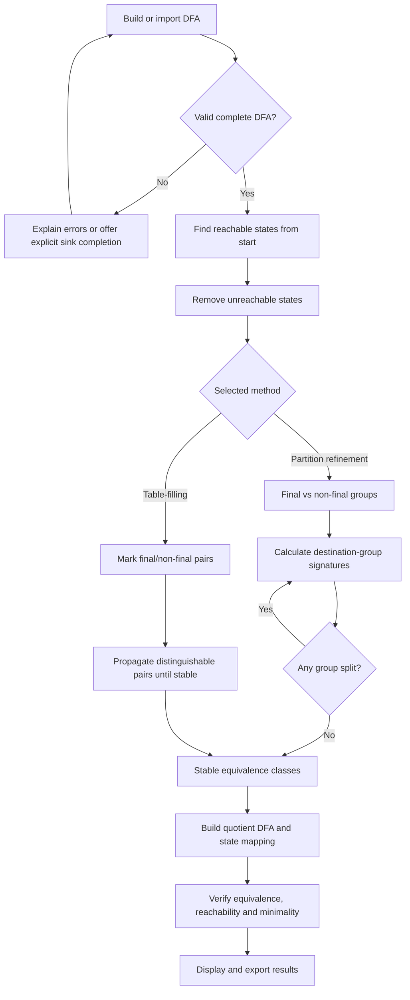
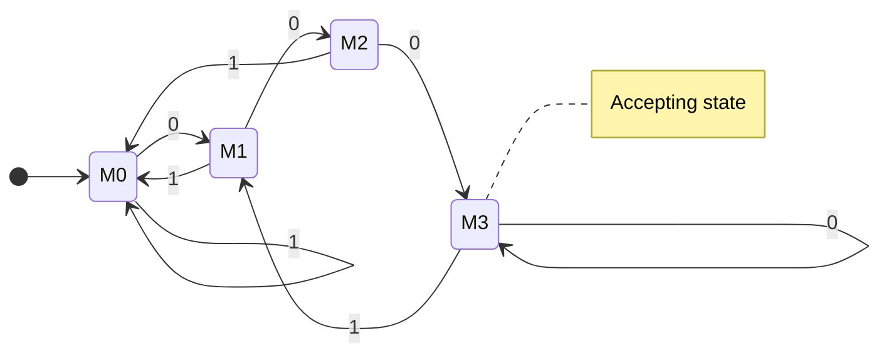

# DFA Studio — Interactive DFA Minimization Simulator

> **Learn the algorithm. See every decision. Build the smallest equivalent automaton.**

**Document status:** Implementation specification, product requirements, design system, algorithm contract, and acceptance checklist. This is a build-ready blueprint for a new web application, not a claim that the application already exists. The implementation is complete only when the acceptance tests in this document pass.

**Product name:** DFA Studio (working name; editable)  
**Audience:** First-time Theory of Computation students, exam preparation, instructors, and users who want to verify a DFA minimization solution.  
**Platform:** Responsive, client-side web application; desktop-first for graph/table editing, fully usable on tablet and mobile.  
**Core objective:** Teach and correctly solve minimization of a deterministic finite automaton (DFA) from beginning to end, with a minimal, polished, accessible interface and replayable explanations.

---

## 0. Instructions for the implementation agent

Treat this README as the source of truth. Read it completely before writing code. Build the actual simulator, not a landing-page mockup. Do not use placeholder buttons, fake algorithm steps, fabricated results, decorative loading screens, or screenshots in place of interactive functionality.

If using an AI coding agent, give it the repository and this README, then use the following instruction:

> Implement DFA Studio exactly as specified in README.md. First inspect the repository, identify existing conventions, and create an implementation plan. Implement and test the pure DFA engine before the UI. Then build the complete interactive workspace, lessons, examples, practice mode, persistent drafts, exports, responsive layout, motion, 3D feature, and accessibility. Use the required worked example and test fixtures to verify correctness. Run lint, type checks, unit tests, end-to-end tests, and a production build. Inspect the actual application at desktop and mobile sizes and correct defects. Do not mark any feature complete unless it works. Document any deviation from this README and why it was necessary. Never invent a passing test or claim to have verified a feature that was not verified.

### Required implementation principles

1. **Correctness before aesthetics.** Algorithms must be deterministic, independently testable, and mathematically correct.
2. **Teaching before animation.** Every visible change must communicate an actual algorithmic operation. Animation never decides the result.
3. **Minimal does not mean incomplete.** Put advanced controls behind sensible disclosure; do not remove essential information.
4. **One source of truth.** The graph, transition table, validation, playback, learning cards, and final result must read the same canonical DFA and trace.
5. **No hidden steps.** Reachability, initial partition, every refinement round, stability, merges, final transitions, and verification are all inspectable.
6. **No unnecessary backend.** Core features work locally, without login, API keys, AI calls, or a database. All explanations are generated deterministically from the actual input.
7. **Progressive enhancement.** A device without WebGL, a reduced-motion preference, or a small viewport must still provide a complete solver.
8. **Honest verification.** Never claim a DFA is minimized unless the algorithm and its postconditions support that claim. Distinguish mathematically proved equivalence from testing a few strings.

## 1. Contents

- [2. Product vision and scope](#2-product-vision-and-scope)
- [3. Learning content and terminology](#3-learning-content-and-terminology)
- [4. Algorithms and correctness contracts](#4-algorithms-and-correctness-contracts)
- [5. Fully worked reference example](#5-fully-worked-reference-example)
- [6. User journeys and information architecture](#6-user-journeys-and-information-architecture)
- [7. DFA builder and validation](#7-dfa-builder-and-validation)
- [8. Simulator and step-by-step learning UX](#8-simulator-and-step-by-step-learning-ux)
- [9. Table-filling and practice modes](#9-table-filling-and-practice-modes)
- [10. Results and equivalence verification](#10-results-and-equivalence-verification)
- [11. Visual design system](#11-visual-design-system)
- [12. Motion, 3D and interaction design](#12-motion-3d-and-interaction-design)
- [13. Responsive design and accessibility](#13-responsive-design-and-accessibility)
- [14. Technical architecture](#14-technical-architecture)
- [15. Data contracts and trace format](#15-data-contracts-and-trace-format)
- [16. Persistence, import and export](#16-persistence-import-and-export)
- [17. Edge cases, fixtures and testing](#17-edge-cases-fixtures-and-testing)
- [18. Performance, security and deployment](#18-performance-security-and-deployment)
- [19. Implementation roadmap](#19-implementation-roadmap)
- [20. Definition of done](#20-definition-of-done)

## 2. Product vision and scope

### 2.1 What the product solves

Students often memorize the final state grouping without understanding why states are equivalent, why unreachable states can be removed, why a group splits, or how the minimized transition table is built. Static textbook diagrams cannot show the intermediate decisions or let a student experiment.

DFA Studio turns the entire procedure into a guided, interactive visual lesson. A student should be able to open the application without knowing the term DFA, learn the prerequisites, load or build an automaton, follow each step at their own pace, predict the next action, and reproduce the same solution in an exam.

### 2.2 Target experience

- **First 15 seconds:** Understand what the simulator does, and see a clear primary action to run a worked example. No registration or setup.
- **First lesson:** Learn the meaning of states, alphabet, start state, final states and transitions in simple English. The initial example is interactive, not a wall of text.
- **First simulation:** See reachable states, removed states, groups of potentially equivalent states, transition signatures, group splits and the reconstructed DFA.
- **After simulation:** Compare the original and minimized DFA, test strings, inspect a formal equivalence check, and download an exam-ready solution.
- **Independent learning:** Create a new DFA and use practice mode, hints, rewind, and explanations without needing instructor assistance.

### 2.3 Required feature scope

| Area | Required release feature |
|---|---|
| Learning | Beginner lessons, glossary, animated examples, worked solutions, exam recap |
| Input | Editable transition table, visual graph builder, alphabet/state configuration, presets, JSON import |
| Validation | Start/final configuration, deterministic transitions, totality check, explicit dead-state completion |
| Algorithms | Reachability removal, partition refinement (default), table-filling (alternative), quotient construction |
| Simulation | Step, previous, play, pause, speed, timeline seek, detail toggle, inspect reasons, keyboard navigation |
| Visualization | Interactive graph, synchronized table, partition cards, split/merge motion, pair matrix |
| Practice | Predict reachable states, splits, pair marks, or final transitions; hints; feedback; progress |
| Verification | String testing with paths, product-automaton equivalence check, distinguishing witnesses, minimality check |
| Results | Original vs minimized graph and table, mapping, counts, explanation, exports |
| Design | Responsive minimalist interface, light/dark themes, purposeful motion, functional 3D overview with fallback |
| Persistence | Local drafts, session progress, settings, clear/reset controls |
| Quality | Unit/integration/E2E tests, accessibility, performance budgets, deployment documentation |

### 2.4 Explicit boundaries

This release supports **deterministic finite automata** only. Do not silently accept NFAs, epsilon transitions, regular expressions, pushdown automata, Turing machines, or wildcard transitions. NFA-to-DFA conversion and regular-expression conversion are future projects, not part of this simulator.

Partition refinement is a straightforward synchronous, Moore-style refinement algorithm; do not call it Hopcroft's algorithm. Table-filling is an independently implemented alternative. Do not mislabel an incomplete transition diagram as a formal complete DFA. The UI supports 1–24 states and 1–8 alphabet symbols to keep the learning visualization manageable. These are product limits, not mathematical limits. Reject inputs beyond limits with an explanation. A completion sink counts toward the state limit.

No accounts, leaderboards, advertising, analytics by default, server-side execution, collaborative editing, external AI, or mandatory internet services. Offline use after initial load can be an enhancement, but must not be advertised unless implemented and tested.

## 3. Learning content and terminology

### 3.1 The minimum prerequisite lesson

Explain a DFA as a machine that reads an input string one symbol at a time. It remembers where it is by using a state. The next state is completely determined by the current state and the next input symbol. When the string ends, the machine accepts the string if it is in a final state.

| Formal concept | Beginner explanation | Visual convention |
|---|---|---|
| Q | All the states the machine may be in | Circles with unique names |
| Σ | Allowed input symbols, the alphabet | Small chips such as `0`, `1` |
| δ | Rule telling the machine where to go next | Directed labelled arrows and table cells |
| q₀ | The state where reading begins | Incoming start arrow |
| F | The states in which a string is accepted | Double-circle states |
| ε | The empty string: read no symbols | Explicit empty-string control |
| Language L(M) | All strings the machine accepts | Examples labelled accepted/rejected |

Formal definition: `M = (Q, Σ, δ, q₀, F)` with `δ: Q × Σ → Q`, `q₀ ∈ Q` and `F ⊆ Q`. For each state and each symbol there is exactly one next state. A complete DFA can have zero final states, or every state may be final. A final state can have outgoing transitions; it is not automatically a stopping state.

Use a two-state even-number-of-ones example. State E is start and final; `E --0--> E`, `E --1--> O`, `O --0--> O`, `O --1--> E`. Let users click `0` or `1` to advance. Show that `101` is accepted and `1` is rejected. Explain ε: it is accepted here because the start state is final. Show a transition-table view alongside the graph so students learn the correspondence.

### 3.2 What minimization actually means

Minimization constructs a DFA with the fewest states that accepts exactly the same language as the original DFA (over the same alphabet). It is not simply removing states with similar-looking arrows.

Teach the two key ideas separately:

- **Unreachable states:** If a state cannot be reached from the start state by any input string, it cannot affect acceptance. It may be removed. Unreachable is not the same as non-final or dead.
- **Equivalent states:** Two states are equivalent when every possible remaining input string produces the same acceptance result from both states. They can safely become one state.

Example: a non-final state and a final state are immediately distinguishable using ε. Two non-final states are not necessarily equivalent; a later input might lead one to a final state and the other to a non-final state.

Define `δ*(q, w)` as the state reached after consuming all symbols of string `w`, with `δ*(q, ε) = q`. Formally, `p ~ q` if for every `w ∈ Σ*`, `δ*(p,w) ∈ F` exactly when `δ*(q,w) ∈ F`. If not, there exists a **distinguishing string** (witness).

A **dead/trap state** is often used for a non-final sink with self-loops on every input. More generally, a dead state has no path to a final state. Such states can be reachable and are not automatically removable: they still describe rejection behavior in a complete DFA. Multiple equivalent dead states may be merged.

The minimal complete DFA is unique up to renaming of states for the same language and alphabet. Explain that state labels and graph position may differ between two correct solutions.

### 3.3 Lesson structure

Use short interactive cards with one idea each; show progress and allow free navigation. Every technical word has an inline glossary link. Do not assume the student already knows graph theory or equivalence relations.

| Lesson | Interactive activity | Takeaway |
|---|---|---|
| 1. What is a DFA? | Follow a string symbol by symbol | Exactly one next state for each input |
| 2. Reachability | Select states you can visit from start | Only reachable states influence the language |
| 3. Equivalent states | Compare two states on a distinguishing string | Equivalent means identical future acceptance, not identical arrows |
| 4. Initial groups | Sort states into final and non-final groups | Final/non-final states cannot merge |
| 5. Refine groups | Compare destination groups and predict splits | Split only when behavior differs |
| 6. Build the result | Replace groups with new states | New transitions go between equivalence classes |
| 7. Verify the solution | Compare strings and inspect exact proof | Same language and no equivalent distinct states |
| 8. Exam recap | Solve a small example with guidance | Write reachability, partitions, stability, mapping and final table |

After each card use one brief question with immediate feedback and a button to open the relevant simulator step. Avoid a separate tutorial that visually contradicts the real engine.

### 3.4 Explanation writing rules

Every step has three levels: **What happened**, **Why it happened**, and optional **Formal detail**. Default to the first two. Use the actual state names, input symbols, groups and destinations from the trace. Define new notation the first time it appears. Avoid saying “obviously”, “trivial” or “just merge”. Do not infer equivalence from a single example string.

Example microcopy: “B and C stay together because reading 0 takes both into group G2, and reading 1 takes both into group G0. Their target state names differ, but their target groups are the same. They remain candidates for equivalence until the partition stops changing.”

## 4. Algorithms and correctness contracts

### 4.1 General pipeline



Core engine functions are pure and cannot import React, a renderer, browser storage, or animation libraries. Never mutate input. Use deterministic ordering: original state order and alphabet order; final groups ordered by the earliest member in original order, with the same convention for stable IDs. Empty partitions are omitted. Alphabet order is retained in signatures and witnesses.

### 4.2 Step 1 — Validate input

Validate the data before any graph traversal. Check unique nonempty state IDs and labels, valid unique symbols, exactly one existing start state, final-state subset, no unknown target IDs, no duplicate `(source, symbol)` entries in raw imports, and one transition for every state/symbol. Validate layout coordinates separately; layout errors must not alter the mathematical DFA. Reject unsupported epsilon transitions. Report all useful errors at once and associate each with a control or cell.

If some transitions are missing, the user may explicitly choose “Complete with a sink state.” Add a uniquely labelled non-final state, redirect every missing cell to it, and give the sink a self-loop for every symbol. Preserve all existing transitions. Preview the changes and require confirmation. If missing transitions were intended to reject immediately, this is the corresponding complete DFA; otherwise the user must fill the cells manually. Once completed, this new DFA becomes the baseline for minimization and exact equivalence verification. Never present this as equivalence to an unspecified incomplete machine. If the state limit prevents adding a sink, explain and require manual correction.

### 4.3 Step 2 — Reachability using BFS

Initialize a queue with the start state and a visited set containing it. Mark a state visited when it is enqueued, not when dequeued. For each dequeued state, inspect all alphabet symbols in order. If a destination has not been visited, mark it visited, record its predecessor and incoming symbol, and enqueue it. This predecessor path provides an explicit string witnessing reachability.

```text
reachable(dfa):
    visited = {dfa.start}
    queue = [dfa.start]
    head = 0
    parent = {}
    while head < queue.length:
        q = queue[head]; head += 1
        emit DequeueState(q, queue[head:])
        for a in alphabet:
            t = delta(q, a)
            isNew = t not in visited
            if isNew:
                visited.add(t)
                queue.append(t)
                parent[t] = (q, a)
            emit InspectEdge(q, a, t, isNew, visited, queue[head:])
    return visited, parent
```

Remove every state not in the visited set, its final-state membership, and all its incident transitions from the working copy. A transition from a reachable state to an unreachable state cannot exist in a valid DFA, because it would make that destination reachable. Assert that property instead of quietly deleting transitions from reachable states. Keep the original DFA unchanged and retain removed states in the trace. Complexity: `O(nk)` time and `O(n)` auxiliary traversal space, where `n = |Q|` and `k = |Σ|` (excluding emitted trace storage).

Explain BFS in plain English: “Start at the start state. Follow every possible arrow. Repeat this for every newly discovered state. If a state was never discovered, no input string from the start can reach it.” Highlight visited states and queue entries. Distinguish “not yet visited” from “proved unreachable”; mark unreachable only after traversal ends.

### 4.4 Step 3 — Initial partition

On the reachable DFA with `r` states, create `P0 = {Qᵣ − Fᵣ, Fᵣ}` after discarding any empty set. Display non-final group first when both groups exist; keep actual group order deterministic after this by earliest member. Group identifiers such as `G0` and `G1` are display identifiers scoped to a partition, not permanent identities. If all reachable states are final or all are non-final, a single group remains and will be stable, giving a one-state minimal DFA.

Explain that final and non-final states disagree on ε, so they cannot be equivalent. The initial groups are only candidates for equivalence.

### 4.5 Step 4 — Synchronous partition refinement (default)

Use the following exact method. Build a mapping `groupOf[q]` from the **entire current partition**, fixed for the duration of a round. For each state, compute its signature: the ordered tuple of group IDs of all destinations for the alphabet symbols. Within each existing group, collect states with the same signature. Split the group into these buckets if there is more than one bucket. Do not combine states from different existing groups. Compute all groups against the same old partition, then commit the next partition simultaneously.

```text
P = initialPartition(reachableDfa)
emit InitialPartition(P)
round = 1
repeat:
    old = P
    groupOf = indexGroups(old)
    next = []
    for block in old:
        buckets = orderedMap()
        for q in block:
            signature = tuple(groupOf[delta(q,a)] for a in alphabet)
            emit SignatureComputed(round, q, block, signature, old)
            buckets[signature].append(q)
        emit GroupDecision(round, block, buckets)
        next.extend(buckets.values())
    next = canonicalize(next)
    changed = any block had more than one bucket
    emit RoundCommitted(round, old, next, changed)
    P = next
    if not changed:
        emit PartitionStable(P)
        break
    round += 1
```

Use structured tuple keys (e.g. JSON encoding arrays of numeric indices), not concatenation that can collide. Group IDs may change when a partition is committed; any explanation of a signature must use the source partition's IDs. Determine stability by membership/split flag, never by group labels or colors. Do not stop when the number of final states is unchanged. Never reassign group IDs mid-round and use them for later signatures in the same round.

A split increases the number of blocks by at least one, so there are at most `r - |P0|` changing rounds followed by one stability round. With a state-to-group lookup and hash buckets, the straightforward algorithm is `O(r²k)` time and `O(rk + r)` working space including transition storage, excluding trace storage and optional canonical sorting. Use input-index iteration to maintain deterministic ordering without repeated heavy sorting where possible.

**Correctness:** P0 separates states distinguished by ε. After `i` refinement rounds, membership corresponds to agreement on all strings of length at most `i`. If a signature differs, a symbol leads into groups already distinguishable by some suffix. When no group splits, final status agrees and transitions under every symbol stay consistent at group level. Induction on string length then proves all states inside a stable block have identical future acceptance. States in different blocks are distinguishable by some string. This yields precisely the reachable equivalence classes.

### 4.6 Step 5 — Construct quotient DFA

For each stable class `C`, create one new state `Mi` with a stable machine ID and display membership (e.g. `M1 = {B, C}`). Use canonical class ordering by earliest original state. New start state is the class containing the original start. A new state is final if its class contains a final state; assert that all members share final status. For every class and symbol, pick its earliest member `q`, set the new transition to `classOf[δ(q,a)]`, then assert every other member has the same destination class. Do not omit self-loops. Maintain the mapping from every reachable original state to its quotient state, and a separate removed-state list for unreachable states.

```text
for C in stableClasses:
    representative = firstMember(C)
    for a in alphabet:
        target = classOf[delta(representative, a)]
        assert every q in C has classOf[delta(q,a)] == target
        newDelta[C,a] = target
```

The final machine is a complete DFA with the same alphabet. It accepts exactly the same strings as the reachable original because mapping the original state after any string equals the quotient state after that string. Every quotient state is reachable, and distinct quotient states are distinguishable. Therefore the machine is minimal.

### 4.7 Alternative method — Table-filling

Remove unreachable states first, exactly as in the default method. Create one cell for each unordered pair of distinct reachable states (not self-pairs), ordered by original state index. Initially mark each pair in which exactly one state is final, with witness ε. Leave other pairs unmarked. In synchronous rounds, for each unmarked pair `(p,q)` inspect each symbol `a`. Compute `(δ(p,a), δ(q,a))`. If the destinations are identical, the pair cannot be distinguished by that symbol alone followed by a suffix; move on. Otherwise canonicalize the destination pair and check whether it was marked at the **start** of the round. If marked, record a dependency and witness `[a, ...destinationWitness]`, then mark the current pair at round commit. Choose the first qualifying symbol in alphabet order. Repeat until no new pair is marked.

```text
marked = map of pairs with different final status, witness = []
emit InitialPairMarks(marked)
repeat:
    previous = snapshot(marked)
    additions = []
    for pair (p,q) not in previous:
        for a in alphabet:
            u = delta(p,a); v = delta(q,a)
            emit PairDependencyInspected(p,q,a,u,v)
            if u != v and canonicalPair(u,v) in previous:
                w = [a] + previous[canonicalPair(u,v)].witness
                additions.append((p,q,a,(u,v),w))
                break
    marked = previous plus additions
    emit PairRoundCommitted(additions, marked)
until additions is empty
```

Unmarked pairs after stability are equivalent. Form classes with a disjoint-set union (DSU) by uniting each unmarked pair, then assert that every distinct pair within a class is unmarked and every pair across classes is marked. DSU alone is not proof of correctness; the stable table establishes equivalence. Use the shared quotient constructor. Both methods must yield identical class memberships independent of group labels. Complexity for this deliberately pedagogical repeated-scan implementation: `O(r²k × R)` time with at most `r(r−1)/2 + 1` scan rounds as a conservative bound; `O(r²)` mark/dependency storage plus witness storage and optional trace. Do not claim it is optimized quadratic table-filling. Store witness links rather than copying all long witnesses if necessary. The finite limits in §2 keep it practical.

### 4.8 Exact equivalence check via product BFS

For two complete DFAs over the same alphabet, start from the pair of their start states. Traverse product states `(p,q)` using each symbol `a` to reach `(δA(p,a), δB(q,a))`. If exactly one component is final, the predecessor chain yields a shortest counterexample string. Check the initial pair too, because ε can be a counterexample. If no reachable pair disagrees, the languages are equal. Reject alphabet-set mismatches; when sets match but order differs, use the first DFA's alphabet order for traversal.

This is an exact decision procedure, not random sampling. Complexity `O(n₁n₂k)` time and `O(n₁n₂)` space in the worst case. Return visited pair count and counterexample tokens (or `null` on success). If equivalent, an empty witness is **not** returned; distinguish `null` from `[]`, which denotes ε.

### 4.9 Minimality verification and state reduction

Independently check all output states are reachable. Run a distinguishability check on every unordered pair of distinct output states (e.g. the table-filling engine when the selected method is partition refinement, or partition refinement plus witness product BFS when the selected method is table-filling). Every pair must be distinguishable. One-state output satisfies pairwise distinguishability vacuously. Use product BFS starting at a selected pair of states in the same DFA to recover a shortest distinguishing string if requested. It must return `null` for equivalent pairs.

Return three independent booleans: `equivalent`, `allStatesReachable`, `pairwiseDistinguishable`. All must be true to show “Verified minimal DFA”. On failure show a clear internal-consistency error, preserve the original input, provide debug details in development, and do not export a falsely verified result.

Reduction metrics: `unreachableRemoved = originalCount − reachableCount`, `equivalentStatesMerged = reachableCount − minimalCount`, `totalReduction = originalCount − minimalCount`, `percentageReduction = 100 × totalReduction / originalCount`. Baseline is the validated, completed DFA, not the incomplete draft. Round percentage for presentation only.

## 5. Fully worked reference example

This fixture must be shipped with the application as **Guided example — 7 states to 4**. Every number, transition, group and explanation below is an acceptance criterion. Alphabet order is `[0, 1]`; state order is `[A, B, C, D, E, F, U]`; start is A; only F is final.

### 5.1 Input DFA

| State | 0 | 1 | Role |
|---|---|---|---|
| A | B | A | Start |
| B | D | A | Non-final |
| C | E | A | Non-final |
| D | F | A | Non-final |
| E | F | A | Non-final |
| F | F | C | Final |
| U | U | F | Unreachable |

The editable reference graph must contain all seven nodes, with an incoming start arrow at A and a double circle at F. U has an arrow to F but has no incoming path from A, so the arrow does not make U reachable.

### 5.2 Find reachable states

With BFS and alphabet order 0, 1, discovery order is `A, B, D, F, C, E`. The following strings demonstrate reachability from A:

| State | Shortest discovery string |
|---|---|
| A | ε |
| B | 0 |
| D | 00 |
| F | 000 |
| C | 0001 |
| E | 00010 |

Remove U only. Reachable states in canonical input order: `{A,B,C,D,E,F}`. The app should explain why neither U's self-loop nor its outgoing edge to F can make U reachable.

### 5.3 Initial partition P0

`G0 = {A,B,C,D,E}` (non-final); `G1 = {F}` (final).

### 5.4 Round 1 — Calculate signatures against P0

| State | Destination on 0 | Destination on 1 | Signature (0, 1) |
|---|---|---|---|
| A | B → G0 | A → G0 | (G0,G0) |
| B | D → G0 | A → G0 | (G0,G0) |
| C | E → G0 | A → G0 | (G0,G0) |
| D | F → G1 | A → G0 | (G1,G0) |
| E | F → G1 | A → G0 | (G1,G0) |
| F | F → G1 | C → G0 | (G1,G0) |

D and E split away from A, B, C because reading 0 immediately leads to acceptance for D/E but not for A/B/C. F stays in its own existing group even though its signature matches D and E: final and non-final states cannot be combined.

**P1:** `G0 = {A,B,C}`, `G1 = {D,E}`, `G2 = {F}`.

### 5.5 Round 2 — Calculate signatures against P1

| State | Destination on 0 | Destination on 1 | Signature (0, 1) |
|---|---|---|---|
| A | B → G0 | A → G0 | (G0,G0) |
| B | D → G1 | A → G0 | (G1,G0) |
| C | E → G1 | A → G0 | (G1,G0) |
| D | F → G2 | A → G0 | (G2,G0) |
| E | F → G2 | A → G0 | (G2,G0) |
| F | F → G2 | C → G0 | (G2,G0) |

A splits away from B and C. Why? Reading 0 from A reaches the group `{A,B,C}`, while reading 0 from B/C reaches `{D,E}`. The suffix 0 distinguishes those groups, so `00` distinguishes A and B (and A and C). B and C remain together even though their 0 arrows point to D and E respectively.

**P2:** `G0 = {A}`, `G1 = {B,C}`, `G2 = {D,E}`, `G3 = {F}`.

### 5.6 Round 3 — Calculate signatures against P2

| State | Signature (0, 1) |
|---|---|
| A | (G1,G0) |
| B | (G2,G0) |
| C | (G2,G0) |
| D | (G3,G0) |
| E | (G3,G0) |
| F | (G3,G1) |

Every existing group is internally consistent; there are no splits. **P3 = P2**, so stop. Make the stability round visible instead of jumping straight from P2 to the final graph.

### 5.7 Construct the new DFA

| New state | Original members | 0 | 1 | Role |
|---|---|---|---|---|
| M0 | A | M1 | M0 | Start |
| M1 | B, C | M2 | M0 | Non-final |
| M2 | D, E | M3 | M0 | Non-final |
| M3 | F | M3 | M1 | Final |

For example, B's 0 arrow goes to D and C's 0 arrow goes to E. D and E are in the same new state M2. Therefore `δ'(M1,0) = M2`. Show this exact operation in the reconstruction animation.



Mermaid above is a reference for documentation only. The actual application uses DFA-specific SVG circles, including a double circle at M3, and interactive edges. Do not use Mermaid as the live graph editor.

**Expected metrics:** 7 original states, 6 reachable states, 1 unreachable removed, 2 additional states merged, 4 minimized states, 3 total states removed (42.9%). The exact product check visits six reachable state pairs and finds no acceptance mismatch. All four new states are reachable and all six unordered pairs are distinguishable.

### 5.8 Same example using table-filling

With six reachable states there are 15 unordered pairs.

| Stage | Newly marked pairs | Witness |
|---|---|---|
| Initialization | AF, BF, CF, DF, EF | ε |
| Round 1 | AD, AE, BD, BE, CD, CE | 0 |
| Round 2 | AB, AC | 00 |
| Round 3 | None | Stable |

Remaining unmarked pairs: BC and DE. Resulting equivalence classes: `{A}`, `{B,C}`, `{D,E}`, `{F}`. Never display U in the reachable-pair matrix. Show dependencies such as `AB --0--> BD`, then `BD --0--> DF`, then DF is initially marked, yielding witness `00` for AB.

### 5.9 Verify with sample strings

| Input | Original DFA | Minimal DFA | Expected result |
|---|---|---|---|
| ε | A | M0 | Reject |
| 0 | B | M1 | Reject |
| 00 | D | M2 | Reject |
| 000 | F | M3 | Accept |
| 0001 | C | M1 | Reject |
| 000100 | F | M3 | Accept |
| 111 | A | M0 | Reject |
| 0000 | F | M3 | Accept |

These are examples for understanding, not proof of language equality. Show the exact product verification separately.

### 5.10 Exam-ready explanation generated by the app

1. Write the original transition table and identify start/final states.
2. From A, discover A, B, D, F, C and E; remove U.
3. Initial partition: `{{A,B,C,D,E},{F}}`.
4. First refinement: `{{A,B,C},{D,E},{F}}`.
5. Second refinement: `{{A},{B,C},{D,E},{F}}`.
6. Third refinement gives no change; the partition is stable.
7. Merge B with C and D with E. Construct the quotient table in §5.7.
8. Start is M0 and accepting state is M3. Minimum number of states is 4.

The generated solution must include actual signatures or the table-filling marks and witnesses, not just partitions. For practice, the user may copy this solution only after choosing Reveal or finishing the exercise.

## 6. User journeys and information architecture

### 6.1 Navigation

Use one coherent application shell. Top bar: small original geometric state-node logo, product name, navigation `Learn`, `Simulator`, `Practice`, and compact theme/settings controls. Add contextual `Help` / `Glossary` accessible from all routes. Do not fill the header with unnecessary menus or social links. On narrow screens collapse navigation into a clearly labelled menu; do not hide solver controls.

| Route | Responsibility |
|---|---|
| `/` | Minimal entry screen, resume draft, guided example, new DFA, learning entry |
| `/learn` | Interactive lesson sequence and glossary |
| `/simulator` | Builder, validation, solver, timeline and results in one workspace |
| `/practice` | Exercises, prediction mode, hints and review |
| `/help` | Input conventions, keyboard shortcuts, theory, troubleshooting and privacy |

Use shareable route paths and preserve draft/progress across navigation. Results live inside the simulator as a stage, not a separate stateful copy. A browser refresh must not silently discard work. If hosting without SPA rewrites, use a compatible hash-routing fallback and document the tradeoff.

### 6.2 Landing screen

The first viewport is functional, not a marketing page. Put a clear headline such as “Make every DFA state count.” followed by one sentence explaining minimization. Primary button: **Run guided example**. Secondary button: **Build my DFA**. Tertiary link: **Learn from scratch**. A saved draft adds a contextual **Resume draft** action with last-updated time. Include a small, functional 3D state-network illustration (see §12) and one compact preview of the original-to-minimal transformation. Use a fixed-height visual region, not a huge hero that hides actions. Do not delay navigation until 3D assets load.

The guided-example button should load the reference DFA and open the first simulation step, with a clear way to inspect/edit the original input. If unsaved changes would be overwritten, show a confirmation with Cancel as the safe option.

### 6.3 Default custom flow

`Build → Validate → Choose method → Simulate → Verify → Review / Export`.

Method selector appears once before solving; default is Partition refinement with “recommended for beginners.” Alternative is Table-filling with “often used in written exams.” Switching method recomputes the trace for the same validated baseline and resets to the first step after confirmation if progress would be lost. It never edits the original input.

### 6.4 Desktop workspace blueprint

```text
┌────────────────────────────────────────────────────────────────────────────┐
│ ◇ DFA Studio       Learn  Simulator  Practice              Help  Theme    │
├────────────────────────────────────────────────────────────────────────────┤
│ Guided example     [Build] [Reachability] [Refine] [Merge] [Verify]        │
├────────────────┬───────────────────────────────────┬───────────────────────┤
│ Steps          │  DFA graph    [Fit] [+] [-] [Reset]│  Round 1 · 2 of 5     │
│ 1 Reachability │                                   │  What happened?       │
│ 2 Initial      │         Interactive graph         │  D/E have a different │
│ 3 Refine       │                                   │  destination group.   │
│   Round 1      ├───────────────────────────────────┤  Why?                 │
│   Round 2      │ Table | Signatures | Groups       │  Read symbol 0 ...    │
│   Round 3      │  Synchronized tabbed data panel   │  [Formal detail]      │
│ 4 Merge        │                                   │  [Try a prediction]   │
│ 5 Verify       │                                   │                       │
├────────────────┴───────────────────────────────────┴───────────────────────┤
│ [Previous]  [Play/Pause] [Next]   ━━━●━━━━   Step 14/42   Speed 1×  Details │
└────────────────────────────────────────────────────────────────────────────┘
```

Wireframe is illustrative; step counts are dynamic, not hard-coded. For wide screens, use an approximately 210 px left rail, flexible central canvas, 320–360 px right inspector, and sticky playback bar. Use `min-width: 0` on grid children to prevent overflow. The layout must resize to fit smaller screens and user zoom, not force exact dimensions. Left rail is a navigation aid, not the sole route to any step.

### 6.5 UI state matrix

Every screen must have meaningful initial, loading (only actual asynchronous work), empty, valid, invalid, error and success states where applicable. Examples: empty transition cell with “Choose destination”; missing start state with a focusable link to the start control; zero unreachable states with a clear positive explanation; no equivalent groups with “This DFA is already minimal after reachability removal.” A crash boundary offers recovery to the last saved draft. A verification failure is an error, not a success screen with a warning hidden in small text.

## 7. DFA builder and validation

### 7.1 Entry layout

Start with a small editable sample (two states and alphabet 0,1) for new users or offer a clearly labelled blank configuration. At the top, provide `Name`, `States`, `Alphabet`, `Start state`, and `Final states`. Users may rename state labels without altering stable IDs. The start state must be explicitly chosen if not defaulted; final-state selection is a multi-select. State count and alphabet count are derived, not competing sources of truth.

The primary editing surface is the transition table because it makes completeness obvious. The visual graph is equally functional and synchronized; expose a simple toggle or tabs on mobile and split view on desktop. Every edit is undoable, and graph drag/zoom changes only layout, not transitions.

### 7.2 Transition table

Rows are states; columns are symbols in input order. First column contains a state label and role markers. Each transition cell opens a labelled combobox of target states. Support arrow-key navigation, keyboard selection, and row/column headers. Show a double-circle icon for final rows and a start arrow for the start row, with text accessible to assistive technology. Missing transitions are shown as `—` with a visible “Missing” status; do not default silently to self-loops. Highlight the graph edge when a cell is focused or hovered, and the table cell when an edge is selected. Group multiple symbols into a graph edge only when source and target match; retain each symbol as an independent transition in data and table.

### 7.3 Visual editor

Provide accessible buttons to add states, rename, set start, toggle final, delete, connect, and edit arrows. Dragging nodes moves them without affecting DFA semantics. To create a transition, use “Connect” mode: choose source, choose target (including source for a self-loop), then choose one or more symbols. Show a preview and existing destinations. Replacing an existing transition requires an explicit confirmation (or direct table edit with undo); never create a second destination for the same state/symbol. Escape cancels mode; click empty canvas clears selection. A non-drag alternative for editing connections is always available through the table or selection inspector.

Deleting a state previews all incoming transitions affected and clears them to missing values on confirmation; outgoing transitions are removed. If the deleted state was start, require a new start choice; do not choose a new one silently. Disallow deleting the final remaining state. Removing a symbol removes its transition column, with confirmation when data is lost; adding a symbol creates missing cells. All these changes invalidate old traces and results. Add an undo/redo stack with meaningful labels, capped at 50 edits. A new edit after undo clears the redo branch.

### 7.4 Input conventions and limits

State labels: 1–24 Unicode code points after trimming, unique, case-sensitive, no control characters. State IDs are opaque stable strings generated separately; never use labels as React keys or array indices as identity. Alphabet tokens: 1–12 Unicode code points, unique, case-sensitive, no whitespace, commas, control characters or reserved tokens `ε`, `ϵ`, `∅`. Token count is 1–8. Use a chip input with explicit add/remove controls and parsing feedback. Duplicate labels or symbols are rejected, not silently collapsed. Treat symbols as atomic tokens rather than assuming a character equals a symbol.

String tester: if all alphabet tokens are one Unicode code point, unseparated input is split by Unicode code point (not UTF-16 code units). Whitespace/comma-separated tokens may also be entered. When any token contains multiple code points, require token separation with spaces or commas, explain using examples, and do not guess ambiguous segmentations. A single known multi-character token can be entered as one token. A dedicated **Empty string (ε)** action is unambiguous; blank input may mean ε only after the user explicitly runs the test. Reject unknown tokens with position and allowed-token suggestions. The displayed `ε` is notation, not an alphabet token. Cap test input at 200 tokens with a clear message.

### 7.5 Validation presentation

Use a persistent small status area above the table: e.g. “12/14 transitions defined · 2 missing”. Show issues in a summary that links to their exact controls. Errors use both icon and text (not red alone). The Solve button is disabled until valid, with adjacent explanatory text accessible without hover. If only missing transitions remain, offer manual fill or the explicit sink completion flow. Unreachable states, all-final/no-final configurations, and redundant states are not validation errors.

The solver takes an immutable validated snapshot. If the user returns to edit after solving, confirm when an existing trace will be invalidated; preserve original input and reset simulation on commit. No stale result may be labelled as representing an edited DFA.

### 7.6 Presets

Ship at least eight labelled examples with short learning goals: even number of ones (already minimal), the 7-to-4 guided example, one reachable state, unreachable accepting state, no accepting states, every state accepting, reachable dead-state example, and a multi-symbol-token example. Add a separate incomplete-DFA validation exercise; never let it enter minimization before completion. All presets have expected results and automated tests (§17).

## 8. Simulator and step-by-step learning UX

### 8.1 Stage A — Reachability

At entry, all nodes are neutral except start. Show a small queue and visited list, current node and highlighted edge. On each inspect action, animate a directional highlight along the actual SVG path. If newly discovered, add the destination to queue and visited list; explain the string that reaches it. If already visited, explain that re-enqueueing is unnecessary. On completion, list reachable and unreachable states, fade unreachable nodes only after they are proved unreachable, and provide a dedicated removal step. A “Show original” toggle restores ghosted unreachable nodes for comparison without altering the working graph. If no state is unreachable, show a successful no-op removal step with reasoning.

### 8.2 Stage B — Initial partition

Represent groups as cards containing state chips, plus synchronized group outlines or node accents. Show `P0` notation. Explain final/non-final difference and provide a button to test ε from two selected states. If one group is empty, omit it and show why. The current partition and original graph must remain understandable without color. Never present tentative groups as already proven equivalent.

### 8.3 Stage C — Refinement

For each round display:

- Source partition `P(i−1)` with a stable group legend and state membership.
- Signature table: row state, columns per alphabet symbol, target state and target group, full tuple, decision.
- Current inspected state or group and corresponding graph transitions.
- Pending buckets, labelled “proposed next groups,” distinct from committed groups.
- Round summary with old and new memberships, reason for each split, and whether the round changed anything.

Default detail level is meaningful **Concept steps**: show one group decision or one round commit at a time, while keeping the full table available. **Every operation** mode reveals individual edge checks and state signatures from the same trace. Both modes must include all algorithm stages, and a user can toggle detail without recomputing or changing the outcome. Use a stable event ID to find the same or nearest preceding visible step when switching granularity. In an explanation, render clickable state chips and destination groups. Clicking a group highlights all its members; selecting a table row highlights its state and current outgoing transition. Hover preview must never move the timeline.

Split animation: duplicate the old group card as visual layers only, move each state chip to its correct bucket, then commit new cards together. No actual data update during the animation; the selected trace snapshot is the authority. Use group labels, patterns and membership counts, not just color. Allow comparison against the old partition after commit. Continue until one full round produces no split. Display stability explicitly: “Every state in each group has the same destination-group signature. Another round will not split these groups.” Provide optional proof detail and distinguishing strings for cross-group examples.

### 8.4 Stage D — Reconstruction

Show stable groups and their new labels (`M0`, `M1`, ...). Animate one group becoming one node, preserving source membership in a tooltip/inspector. Singleton groups are relabelled without implying they were merged with anything. Build quotient transitions one class/symbol at a time; show representative destination and confirm consistency for other members. The start marker and double-circle final status are inherited correctly. Provide a new transition table alongside the graph. If several symbols share the same new endpoints, consolidate their edge labels without losing table entries.

### 8.5 Stage E — Verification

Present equivalence, reachability and pairwise distinguishability as separate checks. For product verification, show a compact table of discovered pairs, current pair, final-status agreement and next pair under each symbol; offer an optional detailed path view. A successful check should say “No reachable state pair disagrees on acceptance; therefore the languages are equal.” Display minimality proof in simple language and optional formal detail. Results remain available for review and testing.

### 8.6 Playback contract

`Previous`, `Next`, `Play/Pause`, timeline scrubber, restart, speed selector (0.5×, 1×, 1.5×, 2×), detail switch, stage navigation and keyboard controls must work. At first/last step, disable unavailable controls with visible state. Play advances through actual trace events only; it pauses at the end, on user manual seek, on route change, when editing input, when a practice prompt opens, and when the page becomes hidden. Speed changes affect future playback timing. Backward seeking reconstructs a snapshot, not inverse mutations. Rapid clicking, restart during animation, or switching methods must cancel obsolete animation and timers; no race can change the canonical result.

Use a single playback controller with one pending timeout or animation-completion signal, cleaned up when dependencies change. Trace is precomputed from the pure engine. A tick updates cursor to the next visible event; rendering is derived. Concept mode uses an interval around 1.4–2.0 seconds at 1× for readable explanation; operation mode around 0.7–1.2 seconds. Add an optional “Pause on round summaries” setting enabled by default for beginners. Do not autoplay on first load. Manual stepping never waits for animation. Keyboard: left/right previous/next, Space play/pause when focus is not in a text input or interactive control, Home/End first/last step in the simulator context. List shortcuts in Help; do not override browser/system shortcuts.

Timeline stages are clickable and have completed/current/upcoming text. A range input exposes accessible value text like “Round 2, signature for B, step 18 of 42.” Screen-reader announcements should occur on manual meaningful step changes, throttled or disabled for autoplay to avoid chatter. When a step changes, keep keyboard focus on the control the user used.

### 8.7 Explanation inspector

Top: a short active-step title. Below: `What happened?`, `Why?`, a compact worked expression or mini table, and optional `Show formal detail`. Add `I don't understand this` which reveals a deterministic simpler explanation of the current operation and links to the relevant lesson. Do not implement a fake chatbot. Include glossary popovers on terms, with click/keyboard activation and escape dismissal. On small devices, show the explanation directly above or below the graph with clear ordering and never require hover. The inspector must reflect the current step even when the user jumps backward.

## 9. Table-filling and practice modes

### 9.1 Pair matrix UI

Render a triangular matrix with row/column state labels, diagonal disabled and duplicate half omitted. Each unordered pair is a single interactive cell. Display distinct statuses: `·` unmarked, `×` distinguished, `?` currently checking; use icon plus text accessible label, and a clear legend. A marked pair can be selected to inspect its reason and shortest recorded witness. For a pair that remains unmarked after stability, show “Equivalent after the final round”; before stability say “Not yet distinguished,” not “Equivalent.” Current dependencies are linked with a subtle path or highlighted cell; do not draw an unreadable overlay across the whole matrix. At most one dependency chain is visible at a time.

Show a round counter, new marks count, the source snapshot, and newly proposed marks. Provide a linear pair list with filtering (all, marked, unmarked, newly marked), useful for small screens and keyboard/screen-reader access. Pair selection highlights both graph nodes. The alternative method shares the same reachability, reconstruction and verification stages and the playback contract. Concept mode groups scans by round or selected pair; full detail lets users inspect every attempted dependency. Never lose access to the final matrix.

### 9.2 Practice experience

Practice is a guided exercise layer on top of the exact same engine, not a separate mathematical implementation. Provide a preset difficulty selection (Beginner, Intermediate, Challenge), and “Practice with my DFA.” Allow practice to be skipped without losing the current trace. A practice prompt pauses autoplay; the engine stores the expected answer but does not show future results until the learner submits, skips, or explicitly reveals. Returning to earlier steps is allowed, but future steps and solution export are gated until the corresponding prompts are completed/revealed. Do not imply cheating prevention; this is self-study.

| Exercise type | Answer control | Validation |
|---|---|---|
| Reachability | Select state chips | Set equality; order irrelevant |
| Initial partition | Sort/select group membership | Set-of-sets equality, order-independent |
| Refinement | Predict whether a group splits; choose buckets | Compare canonical membership, not display labels |
| Distinguishing string | Input tokens, test from two states | Accept any valid string that actually distinguishes the states |
| Table-filling | Select pairs to mark for current synchronous round | Compare unordered pair sets against round additions |
| Quotient transition | Select target group | Compare stable class ID |
| Minimality | Predict final count | Numeric equality |

Feedback: correct answers get a short reason, not only a green check; incorrect answers identify the specific misunderstanding (e.g. “F and U are not both reachable just because U points to F”). First hint explains the rule, second highlights relevant evidence, third allows reveal. An incorrect answer does not change the trace or force reset. Avoid punitive scoring; show attempted, solved independently, solved with hints, and revealed counts. Progress persists locally. After completion, show a review of mistakes and relevant lesson links. Practice sets must include both algorithms and at least one already-minimal case.

## 10. Results and equivalence verification

### 10.1 Summary screen

Use a clear title: **Minimized DFA** only after all verification postconditions pass. Show three restrained metric tiles: original states, minimized states, reduction. Include a breakdown of unreachable removal versus equivalent-state merging. Example: `7 → 4 states`, `1 unreachable removed`, `2 merged`, `42.9% reduction`. A verified status uses an icon and text, never solely color. No confetti or distracting celebratory overlays.

Side-by-side Original / Minimal diagrams share alphabet, styling, zoom controls, consistent state roles and labelled membership. Each has Fit/Reset. A toggle enables synchronized zoom if useful; default independent fit keeps both readable. On mobile, use stacked diagrams or a labelled segmented comparison control with both tables accessible. Selection in the mapping table highlights original states and their corresponding quotient node. Removed states show “Unreachable — removed,” not a fake mapping target.

### 10.2 String testing lab

One input, both machines. Display parsed tokens as chips; show a cursor at the current token and state path for each DFA. Step or run through both in lockstep. Test must start at each machine's own start state, even if a different node was selected in the graph. Final acceptance is determined only after all tokens are consumed. Show final state, accepted/rejected, path and consumed tokens. Include an empty-string button and a few deterministic example strings. A mismatch is a correctness failure and surfaces a counterexample; do not merely show a red result and continue claiming equivalence. An individual-string test is labelled “Example check, not a proof.” Formal verification is a separate panel.

### 10.3 Export and review actions

Buttons: `Download solution`, `Export minimized DFA`, `Export diagram`, `Edit original`, `Try another example`. Export requirements in §16. Also provide `Review steps` linking to the stability round or earlier explanation. Show exact method used, input alphabet, original and final state counts, verification details and final table. Distinguishing witness inspector accepts any pair of states in the reachable original or minimal DFA and displays both paths; if no witness exists after exact check, explain equivalence. Do not assign witnesses to removed unreachable states in the minimization trace; a separate explicit comparison of original states could be added later.

## 11. Visual design system

### 11.1 Art direction

Aim for a premium, restrained educational engineering tool: the clarity of a well-designed technical notebook, the precision of a modern developer tool, and the small delightful interactions of a carefully crafted consumer application. Create an original identity. Do not copy another product's branding. The graph and explanations are the visual focus; the chrome should recede.

Avoid generic AI-generated dashboard aesthetics: excessive rounded cards inside cards, large glowing gradients, neon purple everywhere, massive headline typography, excessive glassmorphism, distracting background particles, random shadows, overuse of badges, meaningless statistics, emoji in place of UI icons, ornamental charts, and text that says nothing. No skeuomorphic browser window around the app. Use whitespace, typography, line weight, alignment and precise interactions to communicate polish.

### 11.2 Design tokens

Use CSS custom properties and semantic token names; do not scatter raw hex colors across components. The following is a starting palette, to be adjusted if measured contrast fails. Apply semantic tokens consistently in both themes.

| Token | Light | Dark | Usage |
|---|---|---|---|
| `--bg` | `#F7F8FA` | `#111318` | App canvas |
| `--surface` | `#FFFFFF` | `#191C23` | Workspace panels |
| `--surface-subtle` | `#F0F2F5` | `#222630` | Inactive tabs, subtle rows |
| `--text` | `#171C27` | `#F1F3F8` | Primary text |
| `--muted` | `#505B6B` | `#ABB4C3` | Secondary text |
| `--border` | `#DCE1E8` | `#343B48` | Dividers, decorative borders |
| `--control-border` | `#788395` | `#788395` | Interactive outlines where needed |
| `--accent` | `#344BC6` | `#A6B2FF` | Links, current step, active edges |
| `--primary` | `#344BC6` | `#A6B2FF` | Primary button background |
| `--on-primary` | `#FFFFFF` | `#12162A` | Primary button text |
| `--success` | `#08734A` | `#6CE2AC` | Verified status |
| `--warning` | `#995B08` | `#FFCC79` | Missing transition, caution |
| `--danger` | `#B42335` | `#FF9DA9` | Validation failure |
| `--focus` | `#344BC6` | `#B5C0FF` | Visible keyboard focus |

Group colors are separate from status colors: use a small accessible categorical palette (blue, violet, teal, amber, rose, slate) with light backgrounds, high-contrast borders and dark/light text as appropriate. For more groups than colors, reuse colors with numbered labels and distinguishable border patterns. Group identity is always conveyed by `Gi` and membership. Final-state rings and start arrows remain visible with any group color. Never rely on color alone to indicate a difference, disabled state or answer correctness.

Spacing scale: `4, 8, 12, 16, 20, 24, 32, 40, 48, 64px`. Use 16–24 px workspace padding and 24–32 px section spacing at desktop sizes. Border radius: 8 px controls, 12 px panels, pill shape only for chips or segmented controls when helpful. Thin borders are preferred over shadows; reserve a subtle shadow for floating menus, dialogs and a selected drag item. Use one icon family with 1.5–2 px strokes and consistent 16/20/24 px sizes.

### 11.3 Typography

Use a legible sans-serif system stack (`Inter` if locally available and properly licensed, otherwise `system-ui`, `-apple-system`, `BlinkMacSystemFont`, `Segoe UI`, sans-serif). Use a system monospace stack for transition tables, equations and signatures, not for whole paragraphs. Avoid requiring a third-party font request. Use tabular numerals for counts and timeline positions.

| Role | Size / line-height | Weight |
|---|---|---|
| Landing headline | 36–48 / 1.12 | 650–700 |
| Page title | 24–30 / 1.2 | 650 |
| Panel title | 16–18 / 1.35 | 600 |
| Explanation body | 15–16 / 1.55 | 400 |
| Controls and table | 14 / 1.4 | 400–550 |
| Metadata | 12–13 / 1.45 | 400–500 |

Use readable sentence lengths (roughly 45–75 characters for learning text). Technical details belong behind expansion, not in tiny text. Use actual semantic headings in logical order. Avoid all-caps sentences and excessive emphasis. Respect browser font scaling.

### 11.4 Graph visual grammar

- Node default radius approximately 22–28 px at standard zoom; long labels use an accessible compact label and full label in inspector. Make node hit areas generous without overlapping.
- Start arrow points into the node without an originating state; final state is a double concentric circle. Start + final combines both symbols.
- Directed edges have visible arrowheads meeting the target boundary; self-loops are curved and separately labelled; opposing edges have distinct curves. An edge shared by multiple input symbols uses a clear label such as `0, 1`.
- Canvas is quiet (plain surface or very subtle optional grid); labels use small background cutouts if necessary to keep them legible. Avoid text directly over arrows. Group colors are secondary to semantic roles.
- Active traversal uses a strong accent stroke and direction marker; previously visited nodes use a check or status label; unreachable nodes use dashed outlines or a crossed status. Selected nodes use a visible focus ring independent of algorithm highlighting.
- Deterministic automatic layout: start left, BFS layers proceeding right, stable within-layer ordering, unreachable component separated with a label. Calculate node sizes and offsets from actual content. Use a collision-resolution pass or deterministic layout library if needed. Keep positions stable across simulation steps; do not rerun force layout for every transition. Pin user-dragged positions until auto-layout is explicitly requested. Handle dense graphs with zoom, pan, fit, filtering, a selected-state focus view and table fallback.
- Use SVG for sharp rendering, direct event targets and SVG export. Provide keyboard-focusable node actions and accessible graph summary/list alternative; do not treat the SVG alone as accessible documentation. Provide an edge list for inspecting crowded graphs. Use unique SVG marker IDs per rendered graph to avoid collisions on comparison screen.

### 11.5 Component behavior and microcopy

Primary action: one clear solid button per context; secondary outlined or text button; destructive actions use explicit wording and confirmation when data would be lost. Buttons show pressed, hover, focus, disabled and genuine busy states. A disabled button always has nearby explanatory copy for unavailable actions. Selection controls retain a visible current value. Icons without adjacent text require a tooltip and accessible name; use labelled icons for essential playback controls. Tooltips do not contain required instructions.

Examples of effective microcopy:

| Avoid | Use |
|---|---|
| Execute algorithm | Start minimization |
| Invalid DFA | State B is missing a transition on 1 |
| Process complete | 4 states remain; the language is unchanged |
| No delta | Choose where this arrow goes |
| No group mutation | No group split in this round. The partition is stable. |
| Wrong | Compare the destination groups for symbol 0 again. |

Use no fake skeletons for instantaneous calculations. Long operations show cancellable progress if genuinely necessary. Toasts are for short confirmations such as “Draft saved locally” or “Solution copied”; critical errors stay in context until fixed. Provide a clear empty state for every filtered list.

## 12. Motion, 3D and interaction design

### 12.1 Motion principles

Animation should communicate continuity, cause and effect, hierarchy and feedback. It must never be required to understand the solution. Default to smooth but restrained motions, never an endless loop in the solver. Respect reduced motion at all times, including manual setting and OS preference. Animate transforms, opacity and SVG properties where possible; avoid layout thrashing. Motion is tied to trace events; seeking instantly establishes the correct snapshot.

| Interaction | Duration at normal speed | Easing / purpose |
|---|---|---|
| Button hover / press | 100–150 ms | Fast feedback, tiny translation or opacity |
| Tab / inspector update | 140–200 ms | Soft crossfade; no large sliding text |
| Node discovered | 180–260 ms | Outline reveal and visited label |
| Edge traversal | 280–450 ms | Directional highlight along real path |
| Partition chip split | 320–480 ms | Layout transform from old to new bucket |
| Unreachable removal | 240–320 ms | Fade/desaturate then remove from active graph |
| Group-to-node merge | 400–550 ms | Converge membership into new state |
| Quotient edge reveal | 220–320 ms | Reveal target and arrow label |
| Dialog | 140–220 ms | Subtle fade/scale, no bounce |
| Result compare | 240–350 ms | Gentle entry, not a celebratory overlay |

Use an ease-out curve such as `cubic-bezier(0.2,0.8,0.2,1)` for UI state changes and linear progression for path traversal. Avoid spring overshoot on mathematical state positions; a very small spring on a nonessential card interaction is acceptable. Keep playback interval longer than animations at each speed. Cap animation duration at high speed or skip intermediate decorative transitions. Reduced-motion mode applies transitions immediately or uses a short non-spatial fade, stops automatic orbit, and suppresses moving particles or morphs. Provide Play/Pause for any auto-moving content lasting more than five seconds; preferably no perpetual animations at all.

### 12.2 Specific animation storyboards

**Reachability:** source node highlights → actual edge path draws/highlights → destination receives visited outline → queue gains chip → explanation updates. If destination was already visited, show a brief edge highlight and the “already visited” reason rather than replaying a discovery.

**Refinement:** source group cards stay anchored → signature cells highlight target group IDs → different signatures are indicated → chips move to pending buckets → round commits and legend updates. Do not draw edges to a newly numbered group while the old signature table is displayed without clear source/target context.

**Merge:** highlight group and its members → duplicate visual chips converge toward a new node → show new node's member labels and start/final role → reveal quotient edges in construction order → settle into final layout. Preserve original graph in comparison. The transition should work for singleton groups and cases with no state reduction.

**String test:** input cursor moves one token → current state's corresponding edge highlighted → next state selected in each machine → after final token, show acceptance/rejection. If epsilon, skip traversal and show start-state acceptance explicitly.

### 12.3 Required 3D feature — State Network Explorer

Implement a real, optional-to-view 3D state-network illustration on the landing screen, not a stock image or fake 3D gradient. It is a secondary educational element, not the editor. Use the real reference fixture from §5 (or its canonical quotient) for content. Render spheres/nodes, thin directed connections, and highlighted equivalence group clusters using WebGL (Three.js and React Three Fiber are the suggested stack; a static SVG fallback is mandatory). A simple orthographic or mild-perspective camera and soft lighting should give spatial depth without a game-like aesthetic. Use restrained neutral materials and one accent; avoid shiny chrome, floating unrelated shapes, intense bloom or heavy shadows.

Landing visual requirements:

- Default fixed view shows the original nodes, including a separated U node and state roles; caption explains what the user is seeing. Use an accessible DOM legend and original-state labels. If a 3D edge's direction or labels are not readable, explicitly call the scene an overview and provide the complete labelled 2D diagram beside/within the fallback. The 3D view is never the authoritative transition representation.
- A labelled `Original / Minimized` switch changes from actual original graph to actual quotient, with a short transform and membership-based clustering. Use computed canonical result; do not hard-code a visually plausible but mathematically false result.
- Provide optional drag to orbit plus accessible `Rotate left`, `Rotate right`, `Reset view` controls, and keyboard-operable toggle between original and minimized. No scroll hijacking; orbit should not prevent normal page scrolling on touch.
- Load the 3D bundle lazily after core interface is interactive. Detect WebGL support and context loss; catch runtime errors and substitute equivalent static SVG overview with the same switch. Provide `Turn off 3D` setting. Honor reduced-motion and low-power preference via no auto-orbit and reduced effects. Do not render a blank rectangle while loading; show useful SVG immediately.
- Constrain scene to roughly 260–340 px height on wide landing screens and about 180–240 px on phones. Maintain readable labels; if screen is too small, use 2D fallback instead. Limit device pixel ratio to 1–1.5 for low/normal quality, avoid expensive postprocessing, use demand-driven rendering when idle, pause when offscreen and dispose of meshes, materials and listeners on unmount.

Optional results enhancement: a small 3D original-to-quotient comparison may reuse the same component with the current DFA only if it handles arbitrary graph density, labels and fallback correctly. Do not delay release of the required 2D solver for this optional enhancement. The primary graph/table/matrix is always 2D, accessible and exact.

## 13. Responsive design and accessibility

### 13.1 Responsive behavior

| Width | Required layout |
|---|---|
| ≥ 1280 px | Full three-column workspace, graph and data center, inspector right |
| 1024–1279 px | Narrow left rail or stage dropdown, central graph/data, inspector alongside if space permits |
| 768–1023 px | Two-column or stacked graph/inspector, stage dropdown, sticky playback |
| 320–767 px | Single column, graph/table tabs, explanation in flow, expandable step list, compact sticky playback |

Use content-based breakpoints; these widths are targets. At 320 px, do not allow page-wide horizontal scrolling. A wide table or graph may scroll/pan in its own labelled region; ensure focused cells are brought into view. At 200% desktop zoom, layout should reflow instead of clipping. Sticky controls must not cover content: include safe-area padding and sufficient bottom spacing. Use touch targets ideally ≥44×44 CSS px for primary controls, and never rely on hover. Support touch pan/zoom without trapping normal scrolling; include visible zoom buttons and Fit action. Preserve state when orientation changes. Use `dvh` with a safe fallback for mobile browser chrome; avoid a fixed viewport-height trap.

### 13.2 Accessibility requirements

Target WCAG 2.2 AA; this is an implementation target, not a certification claim. Verify measured text contrast (at least 4.5:1 normal, 3:1 large text) and essential graphical/UI contrast (3:1 where applicable). Validate actual selected, disabled, error, hover, dark-theme and group colors in context; do not assume token contrast is enough. Use semantic buttons, links, tables, headings, forms, fieldsets, labels and dialogs. Provide skip link, logical tab order, visible focus, accessible error descriptions and state text. All mathematical content should have readable text equivalents for notation; render formulas without requiring an image. Use `aria-current` for active step and `aria-pressed` or native control semantics for toggles. Use dialog focus trapping and restore focus to opener. Avoid nested interactive elements and invalid ARIA.

Keyboard-only users must be able to create, edit, validate, solve, play/pause, inspect each signature, select pairs, answer exercises, test strings and export without dragging or interacting with 3D. Each graph has a transition-table/edge-list alternative. Include a textual summary of the current graph and current trace state. Announce important state changes via polite live region; do not announce every animation frame. Screen-reader users can navigate all practice choices and feedback. Use reduced-motion media query and explicit settings; when OS preference is reduce, do not override it with a default full-motion setting. Default theme follows system until explicitly chosen.

Test with keyboard, automated accessibility tooling, and at least one actual screen reader (VoiceOver on macOS or NVDA on Windows). Record test environment and limitations. Include mobile touch and zoom, high-contrast mode/forced colors where practical, and browser text scaling. Accessibility is a release requirement, not an optional polish item.

## 14. Technical architecture

### 14.1 Recommended implementation stack

The following is a concrete, replaceable stack choice for a greenfield implementation. If an existing repository already uses an equivalent stack, preserve its conventions unless there is a compelling reason to change. Select compatible maintained stable releases at implementation time and commit a lockfile; this specification deliberately does not assert current package versions.

| Layer | Recommendation | Reason |
|---|---|---|
| Frontend | React + TypeScript (strict mode) | Typed component and engine contracts |
| Build | Vite | Fast local development and static production build |
| Routing | React Router or equivalent | Learning, practice and simulator routes |
| Styling | CSS custom properties + CSS modules or Tailwind with semantic tokens | Precise design system, responsive themes |
| State | React reducer/context; Zustand if complexity warrants it | Predictable editor and playback state |
| Graph | Custom SVG renderer + deterministic layout utilities | DFA semantics, accessibility, export, trace highlights |
| Motion | Motion for React, CSS transitions, SVG path animation | Layout continuity and cancellation |
| 3D | Three.js + React Three Fiber (lazy-loaded) | Required landing explorer with graceful fallback |
| Validation | Zod or equivalent schema library + semantic validation | Safe import and typed errors |
| Icons | Lucide or one consistent SVG icon family | Lightweight consistent controls |
| Tests | Vitest, Testing Library, Playwright, axe-core integration | Engine, UI, E2E and accessibility |
| Persistence | Versioned localStorage for bounded drafts/preferences | No account or backend |
| Deployment | Static host (e.g. GitHub Pages, Netlify, Vercel) | Simple deploy; no runtime API |

Do not use a backend, graph database, state-machine SaaS, external AI explanation generation or remote rendering. Do not introduce a library solely to reproduce a simple native control. Prefer native HTML semantics and small accessible headless components. Keep Three.js out of the core solver bundle. If using custom graph layout, test geometry; if using a layout library, keep mathematical identity outside it. Renderer dependencies cannot influence the algorithm.

### 14.2 Expected repository structure

```text
root/
├── README.md
├── package.json
├── package-lock.json             # or chosen package manager's lockfile
├── tsconfig.json
├── vite.config.ts
├── index.html
├── public/
│   └── favicon.svg
├── src/
│   ├── app/                     # router, layout, error boundary
│   ├── engine/                  # pure TypeScript, no UI/browser dependencies
│   │   ├── types.ts
│   │   ├── validate.ts
│   │   ├── complete.ts
│   │   ├── reachability.ts
│   │   ├── partition.ts
│   │   ├── tableFilling.ts
│   │   ├── quotient.ts
│   │   ├── equivalence.ts
│   │   ├── witnesses.ts
│   │   ├── runString.ts
│   │   ├── minimize.ts
│   │   └── trace.ts
│   ├── fixtures/                # examples + expected output metadata
│   ├── features/
│   │   ├── builder/             # editor, validation, undo/redo
│   │   ├── simulator/           # stage views, cursor, playback
│   │   ├── learning/            # lessons, glossary, simple explanations
│   │   ├── practice/            # prompts, hints, answer checks
│   │   ├── results/             # comparison, string testing, witnesses
│   │   └── explorer3d/          # lazy scene and SVG fallback
│   ├── components/
│   │   ├── ui/                  # buttons, tabs, dialogs, fields
│   │   ├── graph/               # SVG graph, edges, layout, controls
│   │   └── data/                # table, partition cards, pair matrix
│   ├── store/                   # draft, session, preferences
│   ├── hooks/                   # media, playback, persistence
│   ├── lib/                     # import/export, formatting, token parsing
│   ├── styles/                  # tokens, reset, global styles
│   └── main.tsx
├── tests/
│   ├── unit/                    # fixtures and generated DFA tests
│   ├── integration/
│   └── e2e/
└── docs/
    ├── architecture.md
    ├── algorithms.md
    ├── user-guide.md
    └── verification.md          # actual test results and known limitations
```

### 14.3 State management and data flow

```text
Editor action → draft reducer → validation → validated immutable DFA
                                                ↓
                                    pure minimize(dfa, method)
                                                ↓
                                    result + immutable trace
                                                ↓
User playback action → cursor → derived step snapshot → all views
                                                ↓
                                         explanation renderer
```

Separate state into four domains: `draft` (editable DFA and undo history), `session` (validated input, method, engine version, immutable result/trace, cursor), `view` (zoom, selection, tabs, explanation expansion) and `preferences` (theme, speed, detail, motion, 3D). Practice progress is session-scoped with persistent exercise records. Never copy canonical transitions into component-local state except temporary input text prior to commit. Layout coordinates do not participate in mathematical equality, validation of transitions, or semantic fingerprint. Use stable keys for graph nodes and trace steps. Use selectors to avoid unnecessary rerenders; memoize only where profiling or clear expensive derivation warrants it.

Editor actions must be explicit and testable (addState, renameState, removeState, setStart, toggleFinal, setTransition, addSymbol, removeSymbol, updateLayout, undo, redo, replaceDraft). Distinguish semantic revision from layout revision. The engine does not depend on state labels except presentation and validation, and should use safe maps keyed by opaque IDs/tokens rather than trusting prototype-bearing plain-object keys. A user can change a label or symbol named `constructor` or `__proto__` without corrupting the data model. Use Map or validated arrays; if using records at boundaries, use null-prototype records and own-property checks.

Core solver is synchronous for bounded small fixtures if measurements meet performance targets; for expensive full-detail traces, use a dedicated Web Worker via a serializable message interface. On semantic revision/method change, assign a new job ID; discard late responses from old jobs. On cancellation, terminate the worker or cooperatively cancel and reset the UI. Never accept a partial trace as complete. Do not send data to a network service.

### 14.4 Core engine public API

Implement named functions with equivalent typed signatures. Return discriminated result types for user errors rather than throwing arbitrary exceptions. Reserve exceptions for internal violated invariants and catch them at the UI boundary.

```ts
validateDraft(draft: DFADraft): ValidationResult
completeWithSink(draft: DFADraft): CompletionResult
findReachable(dfa: DFA): ReachabilityResult
restrictToReachable(dfa: DFA, reach: ReachabilityResult): DFA
refinePartitions(dfa: DFA): PartitionResult
fillDistinguishabilityTable(dfa: DFA): PairResult
buildQuotient(dfa: DFA, classes: StateId[][]): QuotientResult
checkEquivalence(a: DFA, b: DFA): EquivalenceResult
findWitness(dfa: DFA, p: StateId, q: StateId): SymbolToken[] | null
runString(dfa: DFA, tokens: SymbolToken[], start?: StateId): RunResult
minimize(dfa: DFA, method: Method): MinimizationResult
getStepSnapshot(trace: Trace, eventIndex: number): StepSnapshot
formatExplanation(event: TraceEvent, context: ExplanationContext): Explanation
```

The type names are specified in §15; define supporting result types in source. All engine public functions that assume validity either accept only a validated branded type internally or assert preconditions. `runString` validates tokens and optional start ID. Use stable order for output states, transitions, and witnesses. `findWitness` returns `[]` if epsilon distinguishes and `null` if equivalent. Engine tests must run in a Node environment without DOM globals.

## 15. Data contracts and trace format

### 15.1 Canonical data model

```ts
type StateId = string;
type SymbolToken = string;
type Method = 'partition' | 'table-filling';
interface State { id: StateId; label: string; }
interface Transition { from: StateId; symbol: SymbolToken; to: StateId; }
interface DFADraft {
  schemaVersion: 1;
  name: string;
  states: State[];
  alphabet: SymbolToken[];
  startStateId: StateId | null;
  finalStateIds: StateId[];
  transitions: Transition[];  // omitted cell means missing; duplicates invalid
  layout?: { stateId: StateId; x: number; y: number }[];
}
interface DFA {
  name: string;
  states: readonly State[];
  alphabet: readonly SymbolToken[];
  startStateId: StateId;
  finalStateIds: readonly StateId[];
  transitions: readonly Transition[]; // exactly |Q| × |Σ|
}
interface ValidationIssue {
  code: string;
  message: string;
  severity: 'error' | 'warning';
  stateId?: StateId;
  symbol?: SymbolToken;
  field?: string;
}
type ValidationResult =
  | { ok: true; dfa: DFA; warnings: ValidationIssue[] }
  | { ok: false; issues: ValidationIssue[] };
interface Group { id: string; members: StateId[]; }
interface Partition { round: number; groups: Group[]; }
interface EquivalenceResult {
  equivalent: boolean;
  visitedPairCount: number;
  counterexample: SymbolToken[] | null;
  // alphabet mismatch is an input error, not this result shape
}
interface MinimizationResult {
  original: DFA;
  reachable: DFA;
  removed: StateId[];
  method: Method;
  classes: StateId[][];
  minimized: DFA;
  mapping: { originalId: StateId; minimizedId: StateId }[];
  verification: {
    equivalent: boolean;
    allStatesReachable: boolean;
    pairwiseDistinguishable: boolean;
    visitedPairCount: number;
    counterexample: SymbolToken[] | null;
  };
  metrics: {
    originalCount: number;
    reachableCount: number;
    minimalCount: number;
    unreachableRemoved: number;
    equivalentStatesMerged: number;
    totalReduction: number;
    percentageReduction: number;
  };
  trace: Trace;
}
```

Arrays are portable for import/export; build indexes (`Map<StateId, Map<SymbolToken, StateId>>`, sets for membership, maps for group indices) once for runtime operations. Preserve order and prevent duplicate final IDs. Treat returned arrays as immutable snapshots by convention and use deep freezing in development/tests to catch mutation. A draft may be invalid; a `DFA` must never be constructed from unvalidated untrusted JSON. State labels are presentation; IDs and tokens are semantic. Layout is not part of `DFA`. New class IDs must be unique within the quotient and deterministic for identical input, e.g. `min-0`; labels M0 etc. Mapping is not constructed by matching labels.

### 15.2 Trace event types

Use a discriminated union keyed by `kind` with stable sequential event IDs and fields needed for replay. The list below is a minimum contract, not a prescription to store redundant snapshots in every event. Use immutable checkpoints and compact deltas. Store indices rather than repeated full copies of large arrays. The same trace drives explanations, practice expected answers, exports and visual state.

| Event kind | Required semantic data | Visible detail |
|---|---|---|
| `run.started` | Method, validated input fingerprint | Concept |
| `reach.started` | Start, visited, queue | Concept |
| `reach.dequeue` | State, queue position | Operation |
| `reach.inspect` | From, symbol, to, new/already visited, predecessor when new | Operation |
| `reach.finished` | Discovery order, reachable, unreachable, witness links | Concept |
| `reach.removed` | Removed IDs, remaining DFA reference | Concept |
| `partition.initial` | Nonempty P0 groups | Concept |
| `partition.roundStarted` | Round, source partition reference | Concept |
| `partition.signature` | State, source group, target state/group per symbol, tuple | Operation |
| `partition.groupDecision` | Source block, buckets, differing signature positions, split flag | Concept |
| `partition.roundCommitted` | Old/next partition, split flag | Concept |
| `partition.stable` | Stable classes, final round | Concept |
| `pairs.initial` | All pairs, initial marks, epsilon witnesses | Concept |
| `pairs.roundStarted` | Round and source mark snapshot | Concept |
| `pairs.inspect` | Pair, symbol, destination pair/same destination, source mark status | Operation |
| `pairs.markProposed` | Pair, dependency, symbol, witness link | Operation |
| `pairs.roundCommitted` | New marks, total marks, changed flag | Concept |
| `pairs.stable` | Remaining unmarked pairs and derived classes | Concept |
| `quotient.classCreated` | Class ID, members, start/final flags | Concept |
| `quotient.transition` | Source class, symbol, target class, member evidence | Operation |
| `quotient.finished` | Minimized DFA and mapping reference | Concept |
| `verify.productPair` | Pair, final status, outgoing pairs | Operation |
| `verify.finished` | Exact verification booleans, witness if failure | Concept |
| `run.finished` | Metrics, result reference | Concept |

Concept-mode cursor indexes the subset of events tagged concept; full-detail cursor includes all. Keep snapshots tied to event IDs, not display list positions. Include algorithm version and semantic fingerprint in session persistence. A `Trace` contains immutable header, ordered events, compact shared data (partitions, mark maps, classes), and checkpoints. Each event carries `id`, `kind`, `stage`, `detailLevel`, and its own payload. `StepSnapshot` contains current stage, visible DFA reference, selected/visited/removed state IDs, active edges, queue, source/pending/committed partitions, matrix marks, quotient progress, verification status and derived explanatory references as applicable. Define defaults for irrelevant stage fields, so a stale highlight from another stage cannot leak.

When reconstructing, locate nearest checkpoint at or before target index, apply intervening semantic deltas in order, and memoize bounded recent results. Checkpoints at stage boundaries and refinement commits are a good default; for long scan stages add periodic checkpoints tuned through profiling. Avoid full deep clones on each event. To test rewind, reconstruct the same index after forward, backward, seek and detail changes and compare semantic snapshots. Trace generation and reducer must not use random IDs, `Date.now()` or UI timing for algorithm data. Explanations should be generated from payload fields with safe text rendering; store templates by event type, not a large set of hard-coded example messages.

## 16. Persistence, import and export

### 16.1 Local saving

Persist a bounded versioned object under an app-specific key such as `dfa-studio:v1`. Include the draft, method, last trace event ID, engine/schema version, preferences, and practice state. Save after semantic edits (debounced ~250–500 ms), flush when navigating or on appropriate lifecycle events, and avoid writing on every animation frame. Do not persist transient hover, animation progress, or a huge trace; recompute from the validated draft and saved method on restore, then map the stored event ID if fingerprint and engine version agree. If they do not, restore the draft and restart trace with a transparent message. Retain layout, theme, motion and speed preferences. If localStorage is blocked, full, unavailable, or malformed, show a nonblocking message and allow JSON export; do not crash or silently promise saved progress. `Clear local data` requires confirmation and clears only this app's keys. Explain that local data does not sync between devices and may be lost when browser site data is cleared.

### 16.2 Import format and example

Accept `.json` via accessible file chooser, optional drag-and-drop, or paste JSON. Max import size 256 KiB; validate JSON syntax, version, shape, semantic constraints and limits before applying. Provide a preview with state/symbol counts and validation errors, plus confirm/cancel. Invalid JSON/unsupported schema must not overwrite the current draft. A structurally valid incomplete draft can be imported into builder for correction with an explicit warning. Reject unknown schema versions with a helpful message; implement migrations only when necessary. Unknown decorative fields can be ignored only after validating known fields; do not execute or render imported HTML, SVG, script, or code. Layout positions must be finite and bounded (e.g. ±10,000), and invalid optional layout falls back to auto-layout with warning.

Example portable input (complete two-state DFA):

```json
{
  "schemaVersion": 1,
  "name": "Even number of ones",
  "states": [{"id":"e","label":"E"},{"id":"o","label":"O"}],
  "alphabet": ["0","1"],
  "startStateId": "e",
  "finalStateIds": ["e"],
  "transitions": [
    {"from":"e","symbol":"0","to":"e"},
    {"from":"e","symbol":"1","to":"o"},
    {"from":"o","symbol":"0","to":"o"},
    {"from":"o","symbol":"1","to":"e"}
  ]
}
```

### 16.3 Required export formats

| Export | Content |
|---|---|
| Original draft JSON | Versioned schema with state IDs, alphabet, start/final, transitions, layout; can include missing cells |
| Minimized DFA JSON | Same importable schema, complete transitions, new state labels; optional layout |
| Solution Markdown (`.md`) | Input table, reachability and witnesses, removed states, chosen method's intermediate steps, stability, mapping, quotient table, verification, metrics |
| Print / Save as PDF | Clean print-friendly solution view, browser print dialog, no workspace chrome |
| Diagram SVG | Original or minimal graph, self-contained vector shapes, labels, markers and viewBox, white or transparent background option |
| Copy solution | Same textual solution in clipboard, with manual selection fallback if permission denied |

Do not label a print action as an automatically generated PDF download. Print CSS uses readable text, repeated table headers where supported, sensible page breaks, light theme, and fit-to-page graph; long matrices can be printed as pair lists. Markdown escapes pipes/newlines in labels and tokens, and uses actual computed data; do not export a canned solution. SVG exporter must XML-escape text, include styles and unique marker definitions, and exclude unsafe markup, external images/scripts, editor handles, hover effects and transient animation. Validate generated JSON can round-trip through the importer. Use safe filenames with sanitized draft name and suffix. Revoke object URLs after download; confirm clipboard failures instead of claiming copy success. Allow original-draft export before solving; only verified solution/minimal exports after successful verification. Practice gating applies to solution exports, not draft export.

## 17. Edge cases, fixtures and testing

### 17.1 Mandatory deterministic fixtures

Fixture notation: entries in each transition tuple follow alphabet order; state order is as listed. Unless specified otherwise alphabet is `[0,1]`. State labels may be used as IDs in test fixtures only; production editor uses stable generated IDs. Assert exact class sets, removed IDs, quotient transitions, final/start role, all verification flags, and agreement between both methods.

| Fixture | Input | Expected |
|---|---|---|
| Guided | §5 table | U removed; `{A}`, `{B,C}`, `{D,E}`, `{F}`; 4 states |
| Already minimal | E:(E,O), O:(O,E); start E; final E | 2 states; no removal/merge; ε distinguishes |
| One state | A:(A,A); start/final A | 1 state, all strings accepted |
| Unreachable accepting | A:(A,A), U:(U,U); start A; final U | U removed, 1 non-final state |
| No final states | A:(B,A), B:(B,A); start A; F=∅ | Both reachable merge into 1 rejecting state |
| All final | A:(B,A), B:(B,A); start A; F={A,B} | Both merge into 1 accepting state |
| Reachable trap | A:(F,D), F:(F,D), D:(D,D); start A; final F | 3 states; reachable trap D retained |
| Equivalent dead states | A:(F,D), F:(F,E), D:(D,E), E:(D,E); start A; final F | `{A}`, `{F}`, `{D,E}`; 3 states |
| Multi-token alphabet | alphabet `[go,stop]`; A:(B,A), B:(B,A); start A; final B | 2 states, `go` accepted, `go stop` rejected |
| Incomplete draft | A: (A,missing); start A; final A | Validation error; explicit completion adds non-final sink; then 2 states |
| Unary chain | alphabet `[a]`; A→B→C→D, D→D; start A; final D | 4 states; two changing refinement rounds and a stability round |
| Unreachable duplicate | A:(B,A), B:(B,A), U:(B,A); start A; final B | U removed before partition; 2 states |

Additional fixture generation: 24-state dense DFA with 8 tokens; self-loops; mutual edges; multiple symbols with same endpoints; duplicate raw transitions; duplicate labels/symbols; unknown target/start/final; empty/invalid alphabet; no states; missing start; repeated final IDs; multi-character and Unicode tokens; state/symbol names containing HTML-sensitive text, pipes, `__proto__` and `constructor`; very long input; corrupted persistence; unsupported schema; failed WebGL initialization. Include duplicate labels differing only by case (allowed if distinct), and input with accidental surrounding whitespace (trim labels/tokens at entry, then validate duplicates).

### 17.2 Unit tests — mathematical engine

- Validation rejects nondeterminism, missing transitions and unknown IDs; valid all-final/no-final DFAs pass. Sink completion only fills missing transitions and adds all sink loops; invalid non-missing errors are not repaired silently.
- Reachability BFS has correct discovery order, witnesses and unreachable list. It never revisits a state unnecessarily. Verify input is not mutated.
- Partition initialization omits empty blocks. Check signatures for every reference state in every round. Confirm synchronous semantics, no cross-block merge and explicit stability round. Unary chain and guided fixture catch premature termination.
- Pair filling uses only previous-round marks, canonicalizes unordered pairs, handles equal destinations, returns actual witness strings, leaves equivalent pairs unmarked and checks class transitivity.
- Quotient construction rejects inconsistent input classes; verify complete transitions, start/final preservation, membership mapping and canonical order.
- Equivalence BFS catches ε mismatch, single-symbol mismatch, longer mismatch, alphabet mismatch, and confirms equivalent differently-labelled DFAs. Every returned counterexample actually produces differing acceptance. For small fixtures test shortest length by enumerating all shorter strings.
- Minimality verifies both reachability and every output pair. `findWitness` returns null for equivalent B/C and DE; returns `00` for A/B; returns ε for A/F. Validate each returned witness by executing the string from the two chosen start states.
- Both minimization methods agree on all fixtures. Running minimization twice is idempotent up to renaming (same state count and equivalent language, each final class singleton in the second run).
- String parsing accepts correct token sequences and rejects unknown/reserved symbols; `runString` returns full path including start, handles ε, and doesn't stop early at a final state.
- Trace replay reconstructs exact snapshots in any seek order. Concept/full-detail views have same final result. Ensure deterministic output on repeated runs and invariance under state renaming.

### 17.3 Generated/property-style tests

Use a deterministic seeded generator for hundreds of complete DFAs (e.g. 300 small DFAs with 1–8 states, 1–3 symbols, random start, accepting subset and transitions). For each:

1. Validate original and run both minimizers.
2. Compare canonical equivalence classes as sets of original IDs and removed-state sets.
3. Check exact product equivalence between original and each output, and check output validity and reachability.
4. Independently verify every distinct output pair by product BFS from that pair, not just the same partition method that generated the classes.
5. Assert count does not increase, count ≥1, and minimization is idempotent up to relabelling.
6. Enumerate strings of length 0–4 (bounded by alphabet size) and compare acceptance as extra regression coverage, not as proof.

Use a fixed seed in CI, print failing seed and full portable DFA JSON, and preserve failures as named fixtures. Add a few metamorphic tests: permute state ordering/IDs, rename labels, reorder alphabet (compare equivalence/class sets, not exact witness ordering), add an unreachable component, duplicate a reachable equivalent state by redirecting suitable incoming transitions, and verify expected semantic invariance. Avoid comparing two algorithms that simply call the same refinement code and claiming independent confirmation.

### 17.4 UI integration tests

- Table edit updates graph; graph connect updates table. Dragging does not change transitions. Deleting a target clears affected cells. Undo/redo restores semantic state and graph. Validation links focus exact fields.
- Guided reference loads and shows actual computed steps. Switching method preserves input but resets trace. Back and forth, rapid Next, speed changes, play/pause, seek, restart, detail switching and browser visibility changes do not produce stale frames.
- Original graph retains U for comparison; minimized graph does not. Group labels and signatures reference correct source partition. Table matrix never labels unmarked cells equivalent before stability.
- Practice order-independent answers pass; wrong answers give grounded feedback; hint/reveal works; future-step gate works; practice does not mutate solver result.
- Exact verification failure (injected mock error in UI test) prevents success status and solution export. Invalid import preserves previous draft. JSON export/import round-trip. PDF print view contains actual solution. SVG export escapes unsafe labels.
- Persistence reload restores correct draft, method and cursor or gives a version mismatch message. Storage failure, quota exceeded and corrupted JSON recover gracefully. Clear data does not delete unrelated site keys.
- 3D lazy-load failure or context loss shows interactive 2D fallback. Reduced motion suppresses spatial animation; playback still works. All required features available without WebGL.

### 17.5 End-to-end release scenarios (Playwright or equivalent)

| ID | Scenario | Acceptance criteria |
|---|---|---|
| E01 | New learner | Open home, load reference, understand start/final, navigate all stages; final 4 states and verified checks |
| E02 | Build custom DFA | Add states/tokens, configure roles, complete table, solve and inspect mapping |
| E03 | Fix incomplete | Solve unavailable, exact error, preview sink, confirm, solve correctly |
| E04 | Compare methods | Reference partition and table-filling both yield identical classes and quotient |
| E05 | Playback | Step, rewind, scrub, pause, speed change, detail change; snapshot remains correct |
| E06 | Practice | Incorrect response, hint, correct response, review; progress persists |
| E07 | Test strings | Reference ε rejected, `000` accepted, `0001` rejected in both; unknown symbol rejected |
| E08 | Import/export | Import valid fixture; reject invalid file; download JSON/MD/SVG; re-import quotient |
| E09 | Mobile | At 320/390 px build/solve/inspect/test; no page overflow, no obscured controls |
| E10 | Keyboard and reduced motion | Complete core flow without pointer, no focus trap; reduced motion respected |
| E11 | Reload | Restore draft, method, cursor; no stale result on edit |
| E12 | 3D failure | Force WebGL unsupported; fallback shows accurate original/minimal overview; solver works |
| E13 | Already minimal and single state | Valid no-op stages and correct zero reduction, not division by zero |
| E14 | Theme | Both themes maintain contrast, focus and graph labels; preference persists |

Run across at least Chromium and WebKit (or documented Safari verification), plus Firefox where supported. Use viewport sizes 1440×900, 1024×768, 768×1024, 390×844 and 320×568. Capture screenshots of entry, builder, active refinement, matrix, result and mobile layout for review. Automated accessibility checks on primary states plus manual keyboard and screen-reader testing; automated checks alone do not prove full accessibility.

## 18. Performance, security and deployment

### 18.1 Performance targets

Measure on documented representative hardware/browser; budgets are acceptance targets, not existing benchmarks. Aim for initial core JS ≤250 KiB gzip excluding lazy 3D and optional export/route chunks, CSS ≤50 KiB gzip; justify any budget overrun with measurements and improvements. Aim for first meaningful interaction within 2 seconds on a reasonable desktop connection, interaction response under 100 ms for common edits, and smooth 60 fps on normal hardware where feasible. The 7-state example engine should complete well below 100 ms; the maximum bounded input should not freeze the main thread. If the largest trace exceeds about 100 ms of main-thread computation, move it into a worker or optimize compact representation. Profile worst-case refinement and repeated pair scans. Limit trace memory (target ≤40 MiB for maximum-size bounded case, measured or estimated from actual data representation) and do not silently truncate steps. If necessary compress repetitive scans into indexed ranges that still expose every operation on demand. No hard-coded benchmark claims in UI.

Keep animation work off algorithm path. Lazy-load learning routes, 3D and rarely used export code where useful. Avoid remounting entire graph for a cursor change. Memoize layout independently of highlights. Use SVG for bounded graph scale; table scrolling/virtualization only if needed, retaining accessible keyboard and screen-reader alternatives. Pause work when document hidden. Test slower CPU via devtools throttling and real mobile if available. Handle 3D offscreen and context loss without rendering continuously.

### 18.2 Privacy and security

User input stays in browser unless the user explicitly exports or shares a file. No tracking scripts, telemetry, remote fonts, uploads or third-party API calls required. Treat imported JSON and labels as untrusted. Render text through safe framework escaping; avoid `dangerouslySetInnerHTML`, eval, string-to-code, and HTML/SVG injection. Escape Markdown, XML and filenames on export. Validate all numeric values and sizes. Do not parse arbitrary executable files. Use safe Maps/sets to avoid prototype pollution. Include Content Security Policy compatible with actual deployment if supported, and test it; do not add permissive exceptions unnecessarily. Pin dependency resolution with lockfile, review licenses and known dependency vulnerabilities, and avoid storing secrets in frontend env variables. A `VITE_` variable is public client data; core app requires none. Exported files contain user-provided state labels; explain before exporting if relevant.

### 18.3 Local development and deployment instructions to implement

Use one package manager consistently. The following commands are the expected npm interface; create matching package scripts and document the actual supported Node version after choosing dependencies.

```bash
npm ci                 # after package-lock.json is committed
npm run dev             # starts local development server
npm run lint            # lint source and tests
npm run typecheck       # TypeScript strict type check
npm run test            # deterministic unit + integration tests, non-watch CI mode
npm run test:e2e        # browser tests (document browser installation first)
npm run build           # creates production dist/
npm run preview         # serves built production app locally
```

On initial project creation before a lockfile exists, use the package manager's install command then commit its lockfile. Set up CI to install locked dependencies, lint, typecheck, unit/integration tests, build, and E2E on the production preview. For Playwright document required browser binaries (`npx playwright install` and platform dependencies when needed). Record actual commands/output summaries in `docs/verification.md` with date and environment. No server or API keys required. Configure Vite base path for repository subpath deployments, and route refresh fallback on SPA hosts. Verify assets, lazy chunks, deep links, exports and 3D fallback from the deployed production URL. Use semantic app metadata, original favicon, and readable error route. Include a simple deployment guide with build output `dist/` and actual host settings; do not imply deployment already happened.

## 19. Implementation roadmap

Implement in this order; do not confuse a completed design or passing component test with a finished feature. Each milestone ends with working code and tests.

| Milestone | Deliverables | Exit criterion |
|---|---|---|
| M0 — Foundation | Repo, typed build, scripts, route shell, design tokens | Lint/typecheck/build green on clean checkout |
| M1 — Mathematical core | Validation, completion, BFS, refinement, table-filling, quotient, verification, witnesses, traces | Reference + all mathematical fixtures and generated tests pass |
| M2 — Builder | Config, transition editor, SVG graph editing, undo/redo, validation, presets | Custom input editable both ways, invalid solve blocked |
| M3 — Guided simulator | Reachability, partition round UI, signatures, playback, inspector, reconstruction | Reference replay correct at every stage, seek stable |
| M4 — Alternative solver | Pair matrix, pair list, dependency view, witnesses | Reference pair marks and final classes match §5 |
| M5 — Results | Mapping, comparison, string lab, exact verification presentation, exports | Verified results and exports round-trip |
| M6 — Learning & practice | Beginner lessons, glossary, prompts, hints, progress | New user can solve independently; answer tests pass |
| M7 — Design polish & 3D | Responsive layout, themes, motion storyboards, landing explorer/fallback | Desktop/mobile visual review, WebGL/reduced-motion tests |
| M8 — Reliability & release | Persistence, accessibility review, performance profile, CI, deployment | All required acceptance checks completed; known limitations disclosed |

Persistence can be integrated earlier wherever appropriate. Use feature flags only during development; remove or hide incomplete features before release. Do not keep placeholder controls visible. Prefer small cohesive commits. Before UI implementation, confirm reference fixture and algorithm contracts against tests. Before release, inspect browser console for errors/warnings, production build and actual deployed assets. Maintain a requirements-to-tests matrix in `docs/verification.md`. Do not optimize or decorate around an incorrect algorithm.

### 19.1 Visual review checklist

Review actual screenshots, not just CSS: consistent margins, baseline alignment, clear hierarchy, node/edge labels readable, start/final visible, graph not clipped, no accidental scrollbars, no unbalanced card stacks, no oversized whitespace that hides the solver, no overlapping sticky bar, no tiny controls, no cropped long labels, readable matrix and signatures, consistent active/focus states, restrained animation, both themes, 3D fallback. Test with 1 state, guided fixture and dense 24-state graph. Verify animated sequences frame by frame for causality; no transient wrong group membership. Ask a first-time learner to complete the reference example without outside explanation if possible and record usability issues rather than claiming a user study occurred.

## 20. Definition of done

This is the final release gate. Every required item must be implemented, tested or explicitly reported as not complete. “Looks good” is not a correctness criterion.

### Mathematical correctness

- [ ] Complete DFA validation prevents invalid minimization.
- [ ] Explicit sink completion handles missing transitions without altering existing transitions.
- [ ] BFS discovers reachable states and removes only unreachable states.
- [ ] Partition refinement is synchronous, displays all signature evidence, and stops only at stability.
- [ ] Table-filling is independently implemented, displays marks and witness dependencies, and agrees with partition refinement.
- [ ] Quotient preserves roles, complete transitions, and original-state mapping.
- [ ] Exact product equivalence, output reachability and pairwise distinguishability pass.
- [ ] Reference example produces the exact 7 → 6 → 4 pipeline, partitions, witnesses, quotient table and metrics in §5.
- [ ] Edge cases, seeded generated tests and independent pair checks pass.

### Complete user experience

- [ ] Landing has immediate actions for guided example, custom DFA and beginner learning.
- [ ] Table and graph editing are synchronized, accessible, and undoable.
- [ ] Every stage has simple “what/why” explanations with optional formal detail.
- [ ] Play, pause, next, previous, speed, timeline, restart, detail levels and stage navigation work reliably.
- [ ] Practice gives meaningful hints and correct feedback without leaking future answers by default.
- [ ] Results show actual original/minimal graph, mapping, metrics, exact checks and example string runs.
- [ ] JSON import/export, solution Markdown, print/PDF workflow and SVG export work.
- [ ] Draft/progress/settings restore on reload; failure states recover without data loss where possible.

### Design and quality

- [ ] Minimal original visual identity, consistent tokens, thoughtful typography and whitespace.
- [ ] Smooth, purposeful split/merge/traversal motion; no animation changes engine results.
- [ ] Functional 3D overview with accurate fixture data, interactive controls and robust 2D fallback.
- [ ] Reduced motion, keyboard operation, semantic text alternatives, visible focus and measured contrast.
- [ ] Responsive at all specified sizes, including 320 px and mobile touch interaction.
- [ ] No placeholders, dead buttons, fabricated content, stale results, distracting loops or inaccessible essential actions.
- [ ] Production build, lint, types, unit/integration/E2E, accessibility checks and performance review completed and recorded.
- [ ] Deployment instructions verified; actual limitations and deviations documented.

### Final handover deliverables

A complete working repository with source code, lockfile, scripts, all fixture data, test suite, this specification, user guide, architecture/algorithm documentation, actual verification report, and deployment instructions. Provide the built application or a deployed URL only if it has actually been created and verified. Include a short walkthrough for a first-time learner and the exact commands used to run the project locally. Record any missing requirements honestly instead of presenting unfinished work as a production-ready simulator.

---

**Product success criterion:** A student who has never studied DFA minimization should be able to learn what a DFA is, create or load one, understand why each state is removed or merged, reproduce every refinement step on paper, construct the minimized transition table, and explain why the resulting DFA accepts exactly the same language — using a polished interface that remains simple even when the underlying mathematics is detailed.
